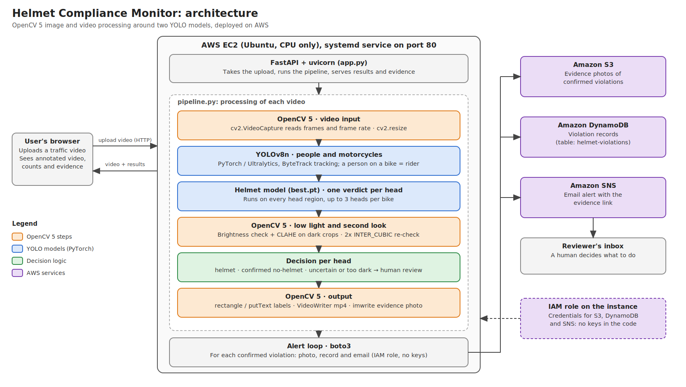

# Helmet Compliance Monitor

Upload traffic footage and the system tracks every person on a two-wheeler, judges each head separately, and flags riders without a helmet. Each confirmed violation produces an evidence photo, a database record and an email alert.

Built for the OpenCV AI Competition 2026.

## What it does

- Detects and tracks motorcycles and people, and treats a person overlapping a motorcycle as a rider.
- Judges **each head separately**, up to 3 per bike (driver plus passengers), labelled `1A`, `1B` and so on. One bike can produce two violations.
- Flags a rider only after a **second, enlarged look agrees**. Unsure cases are marked for human review instead of being accused.
- Saves an annotated video and a result summary, and for each confirmed violation stores a photo in S3, a row in DynamoDB and an email through SNS.

## How the detection works

1. A COCO-pretrained YOLOv8n model (`yolov8n.pt`) detects and tracks people and motorcycles (ByteTrack).
2. A custom model (`best.pt`, classes `helmet` / `no-helmet`) runs on the upper part of each rider's box to find heads.
3. Each head is tracked over time and collects votes. A head must be detected 8 times before it counts as a person, which blocks one-off phantom detections.
4. When at least 70% of a head's detection confidence says `no-helmet` and it has been tracked for about a second, the **second look** runs: head crops spaced about 0.2 s apart are enlarged 2x and re-judged. The violation is confirmed only if at least 3 crops were usable and at least 60% agree.
5. Heads in very dark crops are never confirmed automatically. They go to the review list with the reason "low light".

Result statuses per head: `helmet`, `no-helmet` (confirmed), `uncertain` (leans no-helmet but not confirmed, goes to review) and `checking`.

## Where OpenCV 5 is used

The detection models (YOLOv8) run on PyTorch through Ultralytics, not through OpenCV's DNN module. OpenCV 5.0.0.93 does the video and image processing around them:

- **Video input and output.** `cv2.VideoCapture` reads the frames and the clip's frame rate, size and frame count. `cv2.VideoWriter` writes the annotated mp4.
- **Image preparation.** Frames are resized to a working size with `cv2.resize`. For the second look, stored head crops are enlarged 2x with bicubic interpolation (`cv2.INTER_CUBIC`).
- **Low-light handling.** Each head crop's brightness is measured as the mean of its grayscale values (0 to 255). Crops darker than 90 are converted to LAB colour, their lightness channel is contrast-enhanced with CLAHE (`cv2.createCLAHE`, clip limit 3.0, 4x4 tiles) and they are converted back, both when a head is first judged and again in the second look. Heads darker than 45 are considered too dark to judge: they are never confirmed automatically and go to human review.
- **Evidence.** `cv2.rectangle` and `cv2.putText` draw the bike and head boxes with their labels and status. `cv2.hconcat` joins the re-check crops into one strip, and `cv2.imwrite` saves the evidence photo.

## Architecture



```
Browser -> FastAPI (uvicorn) on EC2 -> pipeline.py (YOLO + tracking)
                                          |
                          confirmed violation (alert loop)
                    +---------------------+---------------------+
                    v                     v                     v
              S3: evidence photo   DynamoDB: record      SNS: email alert
                                   (helmet-violations)   with evidence link
```

AWS access uses the EC2 instance's IAM role, so no credentials are stored in the code or the repo.

## Example result

Clip with a driver and a bare-headed passenger on one bike (20.4 s, 720p):

| Bikes | People | Helmet | No helmet | Uncertain | Violations |
|-------|--------|--------|-----------|-----------|------------|
| 1 | 2 | 0 | 2 | 0 | 2 (`1A`, `1B`) |

Full output: `results/bare_head_perhead.json`. On the deployed CPU-only server the same clip took 57.5 s from clicking Analyze to Done (about 2.8 times real time).

## Setup

Tested with Python 3.12.3. The pinned versions are in `requirements.txt` (CPU-only PyTorch).

```bash
python -m venv venv
# Windows: venv\Scripts\activate    Linux/macOS: source venv/bin/activate
pip install -r requirements.txt
```

`yolov8n.pt` is downloaded automatically by Ultralytics on first run. `best.pt` is included in the repo.

### Run on one video (no AWS needed)

```bash
python pipeline.py path/to/clip.mp4
```

This prints a JSON summary and writes `annotated.mp4` and the evidence photos in `evidence/`.

### Run the web app

```bash
uvicorn app:app --host 0.0.0.0 --port 8000
```

Open `http://localhost:8000`, choose a video and press **Analyze video**.

### Settings for AWS alerts

The alert step reads these environment variables:

| Variable | Meaning | Default |
|----------|---------|---------|
| `S3_BUCKET` | Bucket for evidence photos | none |
| `SNS_TOPIC_ARN` | SNS topic that sends the email | none |
| `DDB_TABLE` | DynamoDB table for violation records | `helmet-violations` |
| `AWS_DEFAULT_REGION` | AWS region | `ap-south-1` |
| `PUBLIC_BASE_URL` | Public address of the app, used to build evidence links in emails | empty |

The IAM role (or credentials) needs permission to write to the bucket, put items in the table and publish to the topic.

## Testing

To check that the installation works, run the pipeline on a known clip and compare the counts.

1. Download the free Pexels clip "A couple riding a motorbike" (link in the Test footage table below) and, to match the reference run, make a 720p copy of it, for example with ffmpeg: `ffmpeg -i clip.mp4 -vf scale=-2:720 -c:v libx264 -crf 28 -an bare_head_720p.mp4`.
2. Run `python pipeline.py bare_head_720p.mp4`. This needs no AWS access.
3. Expected result (the saved reference output is `results/bare_head_perhead.json`): 1 bike tracked, 2 riders tracked, 0 with helmet, 2 without, 0 uncertain, 2 violations (riders `1A` and `1B`, at about 1 s and about 3 s). Counts should match. The exact time at which a violation is confirmed can differ by a fraction of a second between machines.
4. To test the web app, start it with the `uvicorn` command above, open `http://localhost:8000`, upload the same clip and press **Analyze video**. The page should show the same counts and two evidence photos.

## Deployment on EC2

The app runs as a systemd service (`helmet.service`) that starts

```
/home/ubuntu/helmet-compliance-monitor/venv/bin/uvicorn app:app --host 0.0.0.0 --port 80
```

and restarts automatically if it stops. The AWS settings from the table above are kept in a separate override file, `/etc/systemd/system/helmet.service.d/aws.conf`, as `Environment=` lines, so they are not stored in the repository.

To update after pushing changes:

```bash
cd ~/helmet-compliance-monitor && git pull && sudo systemctl restart helmet
```

If the instance is stopped and started again, its public IP changes unless an Elastic IP is attached, so update `PUBLIC_BASE_URL` in `aws.conf` to keep the evidence links in emails working:

```bash
sudo nano /etc/systemd/system/helmet.service.d/aws.conf
sudo systemctl daemon-reload
sudo systemctl restart helmet
```

## Repository layout

```
app.py             FastAPI server and alert loop (S3, DynamoDB, SNS)
pipeline.py        detection, tracking, per-head verdicts, second look
detect.py          early single-image detection script
best.pt            trained helmet / no-helmet model
static/index.html  web page
results/           saved JSON results from test clips
requirements.txt   pinned dependencies
```

## Test footage

All test clips are free stock videos downloaded from Pexels and used under the
Pexels License. The people shown are members of the public or actors, not real offenders.
This prototype is a demonstration, and it flags footage for human review, it does not
issue penalties.

| Clip | Source | Creator | Length |
|------|--------|---------|--------|
| Bare-headed pair (driver + passenger) | https://www.pexels.com/video/a-couple-riding-a-motorbike-5207050/ | cottonbro studio | 20.4 s |
| Night rider | https://www.pexels.com/video/nighttime-motorcycle-ride-under-city-overpass-31909050/ | Mario Spencer | 11.8 s |
| Close-up, bike parked | https://www.pexels.com/video/a-man-riding-a-motorbike-8551058/ | Kindel Media | 9.7 s |
| Bearded man, front view | https://www.pexels.com/video/a-man-riding-a-big-bike-5198984/ | cottonbro studio | 13 s |
| Scooter group | https://www.pexels.com/video/group-ride-of-classic-scooters-on-scenic-road-32189923/ | setengah lima sore | 10 s |
| Scooter with a child in front (vertical video) | https://www.pexels.com/video/father-and-son-scooter-ride-in-indonesia-33635200/ | setengah lima sore | 11 s |
| Solo rider (62 s) | https://www.pexels.com/video/a-man-riding-a-motorcycle-in-the-neighborhood-4310618/ | K | 62 s |
| Racing bikes | https://www.pexels.com/@harveyvillarino/ (creator page; exact clip page to be confirmed) | Harvey Tan Villarino | 9 s |

## Evaluation

The system was run on 8 short stock clips. The true answer for each clip was written down by hand (by the author) before or alongside running it. Eight clips can show how the system behaves, but they are far too few to measure accuracy.

| Clip | Truth | System | Result |
|------|-------|--------|--------|
| Bare-headed pair | 2 riders, both without helmet | 2 riders, 2 violations | correct |
| Night rider | 1 rider, helmet | 1 rider, no violation | correct |
| Solo rider (62 s) | 1 rider, no helmet, alone throughout | 1 rider, 1 violation | correct |
| Bearded man, front view | 1 rider, no helmet | 1 rider, 1 violation | correct |
| Racing bikes | 3 riders, all helmets | 7 riders, 0 violations | verdicts right, rider count too high |
| Scooter group | about 18 people, helmets (one rider unclear) | 18 riders, 1 violation, 2 sent to review | count about right, 1 flag unverified (see Limitations) |
| Close-up, parked bike | 1 rider, no helmet | 0 riders | **miss** |
| Scooter with child | rider with helmet, child in front (apparently no helmet) | rider found, child not found | **child missed** |

Summary: 5 people were clearly bare-headed. The system flagged 4 of them and missed 1 (the close-up). It also did not detect a child who appeared to have no helmet. In total it raised 1 flag that we could not confirm. On 720p clips it ran at about 2.8 times real time on the CPU server (20.4 s clip in 57.5 s, 62 s clip in 2 min 51 s).

## Limitations

- **Close-ups.** The system expects the whole motorcycle to stay visible. In a close-up of a parked bike with most of it out of frame, the motorcycle was detected only in short flashes, so no rider was formed and a bare-headed person was not flagged.
- **Hidden passengers.** A small child seated in front of the rider, partly hidden by the rider's arm, was not detected as a separate person. The trained helmet model rarely finds heads that small or occluded, so a possible missing helmet went unflagged. Retraining with such examples is the main planned improvement.
- **Fast racing footage.** In a clip of racing bikes leaning through corners, the system reported 7 riders for 3 real ones, and one distant bike was not detected at all. All of them were judged as wearing helmets, so no false alarm resulted, but rider counts are unreliable when tracking breaks, and a duplicate rider judged as having no helmet could in principle produce a false violation.
- **Dense groups and small, partly hidden heads.** In a group of about 18 people on closely riding scooters, one small, partly hidden head was confirmed as "no helmet" after the second look. It was reported as Rider #3B, but in the picture it sits next to a neighbouring scooter and may belong to that bike, so heads can be assigned to the wrong bike in dense groups. The author could not tell by eye whether that rider wears a helmet, so the flag is unverified: it may be right or wrong. The second look enlarges the same small image, so it adds little for tiny heads. Sending very small or uncertain heads to human review instead of confirming them is a planned improvement.
- Alerts are sent when a clip finishes processing, not at the instant a violation is detected. The pipeline runs at about 2.8 times real time on a CPU instance, so live camera streams would need a GPU or a faster instance.
- Evidence links go through an open `/files` route over plain HTTP, the demo page has no login, and the photos show identifiable faces. This is acceptable for a short demo with stock footage. Evidence is deleted automatically 21 days after it is created (an S3 lifecycle rule for the stored photos and a nightly cleanup job on the server for the uploaded videos and served copies). A real deployment would need HTTPS, a login, expiring or access-controlled links and face blurring.
- A confirmation can pass on a thin margin (for example 2 of 3 re-checks agreeing), and the exact frame where a violation is confirmed can vary slightly between runs and machines.
- Very dark footage is routed to human review instead of being judged automatically.
- Tested on a small set of clips (bare-headed pair, night rider, two helmeted riders). It has not been evaluated on a large labelled traffic dataset.
- At most 3 heads are tracked per bike, and a head partly hidden behind another rider may be missed in frames where it is not visible.
